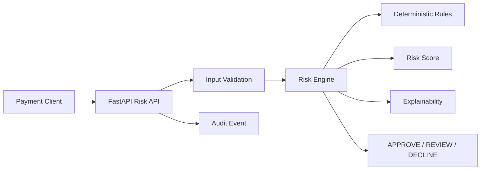

# AI Payment Risk Decision Engine

Production-style reference architecture for real-time payment risk scoring using deterministic rules, explainable scoring, and an API-first design.

> Portfolio project for demonstrating payment-domain architecture, cloud-native APIs, explainability, testing, and governance. Uses synthetic data only.

## Why this project

Payment systems need decisions that are fast, explainable, deterministic, testable, and easy to integrate through APIs.

## Architecture



## Quick start

```bash
python -m venv .venv
# Windows: .venv\Scripts\activate
# macOS/Linux: source .venv/bin/activate
pip install -r requirements.txt
uvicorn app.main:app --reload
```

Swagger: `http://127.0.0.1:8000/docs`

Example:

```bash
curl -X POST http://127.0.0.1:8000/v1/risk/score -H "Content-Type: application/json" -d "{"transaction_id":"tx-1001","amount":1250,"currency":"USD","country":"US","customer_age_days":14,"velocity_1h":8,"device_risk":0.72}"
```

## Example decision

```json
{"transaction_id":"tx-1001","decision":"REVIEW","risk_score":65,"reasons":["high_device_risk","elevated_velocity","new_customer"]}
```

## Highlights

- API-first OpenAPI contract
- deterministic risk rules
- explainable decisions
- unit and API tests
- Docker support
- GitHub Actions CI
- ADR, threat model, and auditability checklist
- synthetic examples

## Repository structure

```text
app/                 # API and domain logic
tests/               # automated tests
docs/                # architecture, governance, threat model
examples/             # synthetic transactions
Dockerfile
requirements.txt
```

## Disclaimer

This is a portfolio reference implementation, not a production fraud model and not intended for real payment authorization without validation, security review, model governance, and regulatory controls.
